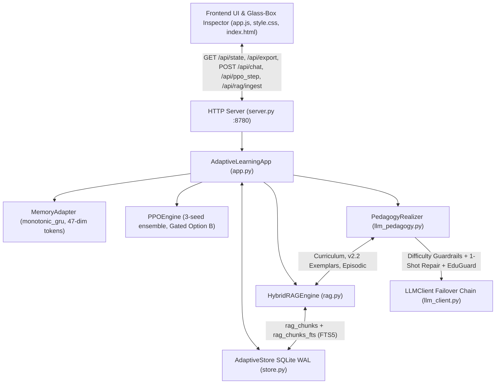

# Phase 1 Hybrid RAG, Mastery-Adaptive Tutor & Guardrails Architecture (`3/adaptive_web/`)

**Branch:** `feat/phase1-hybrid-rag` (under `3/`)  
**Scope:** Hybrid RAG (`FTS5` BM25 + TF-IDF Cosine + RRF `k=60`), Difficulty-Locked Question Synthesis & 1-Shot Schema Repair, Mastery-Adaptive Doubt Tutor with EduGuard Anti-Leakage, Learner-Scoped SQLite Persistence, Multi-Provider LLM Failover, and Glass-Box Inspector Audit.

---

## 1. Architectural Overview

The Phase 1 upgrade adds a bounded, low-latency Hybrid RAG layer and pedagogical guardrails to `3/adaptive_web/` **without touching or retraining** the frozen `monotonic_gru` cognitive memory model (`47`-dim structured evidence tokens, zero text/code embeddings), the frozen 3-seed `delayed_retention_ppo` ensemble (`36`-dim state vector $s_t$), `3/dashboard/`, `3/data_Set/v2.2/`, `3/model/`, or `3/ppo/`.

---

## 2. Three-Corpus Knowledge Base (`3/adaptive_web/knowledge/` & `rag.py`)

`HybridRAGEngine` indexes and isolates three distinct corpora inside SQLite (`rag_chunks` + `rag_chunks_fts`):

| Corpus (`source_type`) | Source Material | Initial Scale | Scope & Privacy Boundary | Purpose |
| :--- | :--- | :---: | :--- | :--- |
| **`curriculum`** | Structured Markdown guides in `3/adaptive_web/knowledge/*.md` + custom docs via `POST /api/rag/ingest` | `24` built-in chunks across 6 skills | Shared curriculum; filtered by active skill (plus direct DAG prerequisites when `include_prerequisites=True`) | Course Material (`generate_course_material`), Hints (`generate_hint`), Doubt Tutor (`answer_learner_doubt`), Difficulty guidance |
| **`v22_exemplar`** | Read-only `catalogue_bridge._RAW_V22_TASKS` | `2,160` items | Metadata pre-filtered on exact `skill`, `difficulty`, and `task_type`; answer keys NEVER exposed to Doubt Tutor | Difficulty-locked few-shot examples in `generate_question()` via `retrieve_exemplars()` |
| **`episodic`** | Learner failed attempts, assisted attempts, solution reveals, and tutor doubts (`record_episodic`) | Dynamic per learner | **Strictly isolated by `(learner, skill)`**; anonymous callers or other learners never see another learner's episodic rows | Personalized remediation reminders in Lesson generation & Doubt Tutor |

### Built-In Python Curriculum Documents (`3/adaptive_web/knowledge/`)

Six Markdown curriculum files correspond 1-to-1 with `PPO_SKILLS_ORDER`:
1. [`range_boundaries.md`](knowledge/range_boundaries.md)
2. [`loop_tracing.md`](knowledge/loop_tracing.md)
3. [`accumulator_initialization.md`](knowledge/accumulator_initialization.md)
4. [`conditional_evaluation.md`](knowledge/conditional_evaluation.md)
5. [`list_indexing.md`](knowledge/list_indexing.md)
6. [`function_returns.md`](knowledge/function_returns.md)

Each Markdown file is chunked cleanly by `#` / `##` / `###` headers via `_chunk_markdown_document()` (max `260` words with `35`-word sliding overlap) covering Core Concepts & Mental Model, Common Misconceptions & Pitfalls, Difficulty Progression (`Easy` / `Medium` / `Hard`), and Prerequisite Connections.

---

## 3. Hybrid Retrieval, Query Rewriting & Reranking (`3/adaptive_web/rag.py`)

Every retrieval call inside `HybridRAGEngine.retrieve(...)` runs a 5-stage pipeline:

1. **Domain Query Rewriting (`rewrite_query`)**:
   - Expands short or vague queries (e.g., `"why 5? off by one"`) using `SKILL_META` titles/summaries, requested `difficulty`/`task_type`, `_PYTHON_SYNONYMS` domain keywords (e.g., `"off by one"` $\rightarrow$ `"range stop exclusive start inclusive boundary len"`, `"return"` $\rightarrow$ `"def function return print None exit scope parameter"`), and optional `extra_context` from the active problem.
2. **SQLite FTS5 BM25 Search (Lexical Stage)**:
   - Safe query tokenization (`_build_safe_fts_query`) extracts alphanumeric/underscore identifiers and quotes tokens so Python syntax (`range(1, 5)`, `lst[-1]`, quotes, `?`) cannot trigger FTS5 syntax errors.
   - Executes `bm25(rag_chunks_fts, 0.0, 0.0, 0.0, 0.0, 0.0, 0.0, 2.0, 1.5, 1.0)` on `rag_chunks_fts` (`tokenize='porter unicode61'`), weighting `title` (`2.0`), `section` (`1.5`), and `content` (`1.0`).
   - Applies strict SQL `WHERE` filtering for `source_type`, `skill`, `learner` isolation (`episodic`), and `v22_exemplar` `difficulty`/`task_type` **before** `LIMIT` so strict filters never starve downstream candidates.
3. **TF-IDF Cosine Search (Dense Lexical/Semantic Stage)**:
   - Uses a process-wide cached `TfidfVectorizer(ngram_range=(1, 2), max_features=8192, sublinear_tf=True, token_pattern=r"(?u)\b[A-Za-z_][A-Za-z0-9_]*\b|\b\d+\b")` fitted once on the static `curriculum + v22_exemplar` corpus (`_load_static_corpus_cache()`), plus on-the-fly `.transform()` scoring for dynamic `episodic` and instructor-ingested `inst.*` rows.
4. **Reciprocal Rank Fusion (`RRF_K = 60`)**:
   - Computes $\text{rrf}(d) = \sum_{s \in \{\text{fts5}, \text{vec}\}} \frac{1}{60 + \text{rank}_s(d)}$.
5. **Pedagogical & Exact-Token Reranking**:
   - Adds metadata bonuses for exact `skill` match (`+0.012`), `difficulty` (`+0.008`), `task_type` (`+0.006`), exact original-query token overlap (`+0.030 * overlap_ratio` so rare ingested/domain keywords outrank expanded generic matches), and mastery-aligned section priorities (`Core` / `Misconception` / `Pitfall` / `Learner History` boosted for `"lacking"` and `"unassessed"`; `Hard` / `Difficulty` / `Edge` boosted for `"mastered"`).

### Performance & Startup Caching
- Static TF-IDF matrix + chunks are cached at the module level (`_STATIC_CACHE`) behind `_STATIC_CACHE_LOCK`.
- SQLite `rag_meta` checks `static_signature` and `rag_chunks` row count so reopened databases skip re-seeding entirely, and fresh test databases seed in single-transaction `executemany` (~`10 ms` for SQLite FTS5, ~`77 ms` cold init in tests).

---

## 4. Question Generation, Difficulty Guardrails & 1-Shot Repair (`3/adaptive_web/llm_pedagogy.py`)

`PedagogyRealizer.generate_question(...)` integrates RAG directly into exercise synthesis:

- **Difficulty-Locked Few-Shot Exemplars**: Calls `self.rag.retrieve_exemplars(skill=skill, difficulty=difficulty, task_format=task_format, exclude_task_ids=exclude_task_ids, top_k=3)` plus `2` curriculum misconception/edge-case chunks.
- **Complexity Guardrails (`_DIFFICULTY_GUARDRAILS`)**:
  - `easy`: `1–5` snippet lines, single core rule, no nested loops, target `reference_seconds` in `15..35`.
  - `medium`: `4–10` snippet lines, `1–2` coupled variables or strided/conditional logic with boundary check, `35..60s`.
  - `hard`: `7–16` snippet lines, compound branching / nested or dependent iteration / negative steps or indices / early return, `60..110s`.
- **Format-Isolated Output Schema Guidance**: Prompt instructions name **only** the requested target `task_format` (`single_choice`, `multiple_select`, `output_prediction`, `fill_in_the_blank`, or `code_completion`) to prevent schema cross-talk.
- **Anti-Duplicate Guard & Validation (`_validate_with_guardrails`)**:
  - Runs `catalogue_bridge.validate_task_schema(cand_task, verify_code_tests=True)` (executing `code_completion` solutions via the sandboxed AST `Interpreter` against all test cases).
  - Enforces easy line-count guardrail and rejects near-verbatim clones of retrieved `v2.2` exemplars (`max_text_similarity(cand_text, exemplar_texts) > 0.85`).
- **1-Shot Schema-Repair Retry**:
  - When live LLM output produces validation or duplicate-guard errors, invokes `self.llm.complete_json(..., schema_name="question_repair")` **once** with `{validation_errors, invalid_candidate, difficulty_guardrail}` and re-validates with `verify_code_tests=True` before falling back cleanly to `sample_v22_task` cloning.
- **Provenance Metadata**: Attaches `rag_citations`, `difficulty_guardrail`, `repair_attempted`, and `rag_audit` onto generated tasks.

---

## 5. Mastery-Adaptive Doubt Tutor & EduGuard (`POST /api/chat`)

`PedagogyRealizer.answer_learner_doubt(...)` and `AdaptiveLearningApp.chat_doubt(...)` make the "Ask the Tutor" feature both mastery-aware and safe against answer leakage during active assessments:

### Mastery Tier Resolution (`_resolve_mastery_tier`)
Using the learner's live cognitive state from `PPOEngine.decide(...)["metrics_by_skill"][skill]`:

| Condition | `mastery_tier` | Pedagogical Adaptation Behavior (Live LLM Prompt & Fallback) |
| :--- | :--- | :--- |
| `not assessed` | **`unassessed`** | Clear foundational mental model, small concrete trace walkthrough, zero assumed jargon |
| `p_med < 0.70` or `observed_pass_rate < 0.70` | **`lacking`** | **Remediation Mode** (`< 70%`): slows down to line-by-line state tables, surfaces boundary pitfalls, boosts prerequisite + episodic mistake chunks |
| `fragility (p_med - p_30d) > 0.15` | **`fragile`** | **Retention Refresher**: skips basic syntax, targets causal decay rules & edge traps |
| Otherwise (`p_med >= 0.70`, stable) | **`mastered`** | Concise precision focused on edge cases, invariants, and downstream composition |

### EduGuard Anti-Answer-Leakage Guardrail (`_enforce_eduguard`)
When `active_question` is open and unpassed (`status == "open"` and not `full_success`) for `(learner, skill)` — or when the learner pastes an unpassed open question across skill tabs (`_is_pasted_active_question`, `similarity >= 0.35` or `__BLANK_`):
1. **Prompt Guardrail**: Injects `EDUGUARD ANTI-LEAKAGE POLICY (ACTIVE)` instructing the model never to reveal the active problem's exact output, option ID/text, fill-in blank, or solution code, and instead use Socratic guidance and a different toy example.
2. **Post-Generation Verifier**: Extracts hidden expected answers from `raw_task` strictly in memory (`_extract_active_answers`) and scans:
   - explicit answer-fishing queries (`_ANSWER_FISHING_RE`, including `"what does it return"`, `"restore the missing"`, `"__blank_"`, `"solve this"`),
   - verbatim/near-verbatim question pasting (`_is_pasted_active_question`),
   - the model's `reply` / `code_example` for direct answer, option, blank, or solution code leaks.
   - If triggered: suppresses leaked `code_example`, formats a structured mastery-calibrated Socratic guide grounded strictly in `curriculum` excerpts (`_clean_excerpt`, never echoing `"Learner asked:"` episodic logs), and marks `guardrail_status = "socratic_redirect"`.
   - Otherwise returns `"grounded_protected"` (open question active, no leak) or `"grounded_open"` (no open unpassed question).
3. **Episodic Doubt Indexing**: After retrieval, `chat_doubt` records the learner's doubt via `self.rag.record_episodic(..., event_kind="doubt")` (and `submit()` / `reveal()` record `"mistake"`, `"assisted_attempt"`, and `"reveal"` events without storing raw answer keys).

---

## 6. Persistence, Learner Scoping & Multi-Provider LLM Failover

### SQLite Store Upgrades (`3/adaptive_web/store.py`)
- **`chat_messages` Table & Index**: Stores `(id, learner, skill, role, message, code_example, source, citations_json, mastery_tier, guardrail_status, created)` with `save_chat_message()` and `get_chat_messages()`.
- **Safe Schema Migration for `generated_tasks`**: Checks `PRAGMA table_info(generated_tasks)` on startup and executes `ALTER TABLE generated_tasks ADD COLUMN learner TEXT NOT NULL DEFAULT ''` plus index `gen_tasks_learner` without dropping legacy rows.
- **Strict Scoping (`app.py`)**:
  - `save_generated_task(raw_task, learner=learner)` tags each LLM-generated task with its owning learner.
  - `list_generated_tasks(..., learner=learner)` and `export(learner)` return only `learner`-owned generated tasks plus `"chat_messages": self.store.get_chat_messages(learner)`.

### Multi-Provider LLM Failover (`3/adaptive_web/config.py`, `3/adaptive_web/llm_client.py`)
- Added `groq` and `ollama` alongside `openai`, `anthropic`, `gemini`, `auto`, and `mock` in `VALID_PROVIDERS`, with provider-specific env keys (`GROQ_API_KEY`, `GROQ_MODEL`, `GROQ_BASE_URL`, `OLLAMA_*`, `OPENAI_*`, `ANTHROPIC_*`, `GEMINI_*`).
- Added `LLM_FALLBACK_PROVIDERS` (comma-separated ordered chain, optionally ending in `deterministic_double`).
- `LLMClient.complete_json()` iterates `self._provider_chain()` automatically on `LLMClientError` (`401`/`403`/`404`/`429`/`5xx`, timeout, network error, invalid JSON), redacts **all** configured keys from exception strings (`_secrets`), and records safe non-secret telemetry in `last_call_info()` (`provider`, `model`, `failover_used`, `attempts`).

---

## 7. API Endpoints & Frontend / Glass-Box Inspector

### Backend API Additions
- **`GET /api/state`**: Now returns `chat_history` (active skill), `chat_by_skill` (full learner chat history map across skills), `rag_audit` (`{corpus, last_retrieval, recent_count}`), `llm_status.fallback_providers`, `llm_status.last_call`, and `glass_box.rag_audit`.
- **`POST /api/chat`**: Returns `{status, skill, reply, code_example, source, citations, mastery_tier, guardrail_status, rag_audit}`, persists both user and assistant messages in `chat_messages`, and respects CSRF & idempotency (`request_id`).
- **`POST /api/select_skill` & `POST /api/ppo_step`**: Include `rag_audit` and grounded `citations` on course material and generated tasks.
- **`POST /api/rag/ingest`**: New CSRF-protected endpoint validating `{skill, title, markdown}` to ingest custom instructor Markdown documents at runtime into SQLite `FTS5` + vector retrieval.
- **`GET /api/export`**: Includes `chat_messages` and learner-scoped `generated_tasks`.

### Frontend UI (`3/adaptive_web/static/`)
- [`index.html`](static/index.html): Added top-bar **Ask Tutor** drawer toggle (`#toggle-tutor-drawer-btn`), full-height side-by-side **AI Tutor Drawer** (`#tutor-drawer` accessible across `Learn` and `Practice`), starter prompt chip bars (`#tutor-starter-chips` / `#drawer-starter-chips`), multiline auto-growing `#tutor-chat-input` `<textarea>`, and bumped cache-busters to `/style.css?v=5` and `/app.js?v=9`.
- [`app.js`](static/app.js): Hydrates `state.chatBySkill` from `/api/state`'s `chat_by_skill`, formats tutor replies with an XSS-safe `renderMarkdown()` helper (headings/bold, bullet & numbered lists, inline code, fenced blocks), renders compact clickable `.citation-chip` source pills (`short_label` + expandable `excerpt` previews) on Course Material and Tutor messages, renders `tier:`, `Live LLM` / `Offline Guide`, and `EduGuard: Socratic` badges, and displays **`RAG & Guardrails Audit`** inside `renderGlassBox()`.
- [`style.css`](static/style.css): Expanded `.tutor-chat-messages` height (`360–540px`) and styled `.tutor-drawer`, `.starter-chips`, `.citation-preview`, `.inline-code`, `.tutor-meta-badge`, `.tutor-meta-guard`, and `.rag-audit-section` using strictly existing dashboard CSS variables (`var(--bg)`, `var(--border)`, `var(--muted)`, `var(--ink)`, `var(--tint-amber)`, `var(--lime-soft)`), maintaining zero gradients and zero purple additions.

---

## 8. File Inventory & Verification Results

### Files Added or Updated on `feat/phase1-hybrid-rag`
| File | Role |
| :--- | :--- |
| [`3/adaptive_web/rag.py`](rag.py) | New Hybrid RAG engine (`FTS5` BM25 + TF-IDF Cosine + RRF `k=60` + query rewriting + clean `short_label` & `excerpt` citations + episodic memory + custom Markdown ingestion + `max_text_similarity`) |
| [`3/adaptive_web/knowledge/*.md`](knowledge/range_boundaries.md) | 6 structured Python curriculum docs (`range_boundaries`, `loop_tracing`, `accumulator_initialization`, `conditional_evaluation`, `list_indexing`, `function_returns`) |
| [`3/adaptive_web/store.py`](store.py) | Added `chat_messages` table, `generated_tasks.learner` migration & learner-scoped queries |
| [`3/adaptive_web/config.py`](config.py) | Multi-provider env config (`groq`, `ollama`, `LLM_FALLBACK_PROVIDERS`) with `repr=False` secret tuples |
| [`3/adaptive_web/llm_client.py`](llm_client.py) | Ordered provider failover chain, multi-key secret redaction, `last_call_info()` |
| [`3/adaptive_web/llm_pedagogy.py`](llm_pedagogy.py) | RAG-grounded lessons/hints/questions, `_DIFFICULTY_GUARDRAILS`, anti-duplicate check, 1-shot schema repair, `_resolve_mastery_tier`, hardened `_enforce_eduguard` & Markdown-formatted fallback |
| [`3/adaptive_web/app.py`](app.py) | Wired `HybridRAGEngine`, episodic event indexing, cross-skill EduGuard check, mastery-aware persisted `chat_doubt`, `ingest_rag_markdown`, scoped `export`, `get_state` fields |
| [`3/adaptive_web/server.py`](server.py) | Added `POST /api/rag/ingest` |
| [`3/adaptive_web/static/index.html`](static/index.html), [`style.css`](static/style.css), [`app.js`](static/app.js) | Full-height Tutor drawer, starter chips, safe Markdown formatter, clickable citation previews, `RAG & Guardrails Audit` |
| [`3/adaptive_web/tests/test_rag.py`](tests/test_rag.py) | 10 new unit & HTTP E2E tests covering Hybrid RAG, difficulty lock, DB migration, isolation, 1-shot repair, mastery chat, verbatim/cross-skill EduGuard, stale-interaction sweep, self-explanation relock, and failover |
| [`3/adaptive_web/TEST_REPORT_AND_CATALOG.md`](TEST_REPORT_AND_CATALOG.md), [`PROJECT_DECISIONS.md`](../../PROJECT_DECISIONS.md) | Updated verification counts and project decision log |

### Verified Automated Test Runs & Live Server Check
- **`3/adaptive_web/tests/test_rag.py`:** `10/10` passed (`OK`).
- **Full `3/adaptive_web/tests/` (`unittest discover -s 3/adaptive_web/tests -p "test_*.py"`):** **`215/215` passed** in `67.506s` (`22` core + `6` pedagogy + `4` chat + `10` RAG/guardrail/failover + `173` E2E Tiers 0–4).
- **Regression Suites:** `3/dashboard/tests/` (**`26/26`**), `3/ppo/tests/` (**`6/6`**), `3/model/tests/` (**`13/13`**) = **`45/45` passed**.
- **Combined Total:** **`260/260` tests passing (`OK`)**.
- **Live Server Smoke Check (`http://127.0.0.1:8780`):** Verified updated assets (`style.css?v=5`, `app.js?v=12`), `Submit Retry` flow, relocked action `5` (`mask[5]=False`), `GET /api/state`, and `POST /api/chat`.
